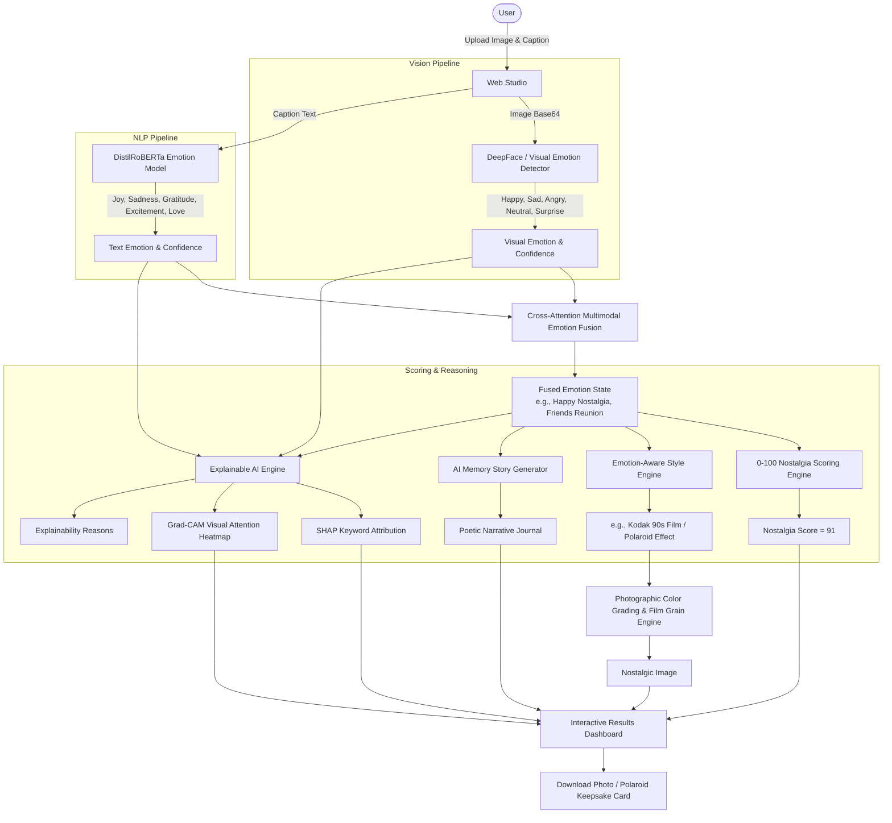

# Emotion-Aware Multimodal Nostalgic Style Transfer with Explainable AI for Social Media

[](https://fastapi.tiangolo.com)
[](https://react.dev)
[](https://tailwindcss.com)
[](https://python.org)
[](LICENSE)

An end-to-end, production-grade multimodal AI web application that revitalizes photographs into emotionally grounded, nostalgic time-capsules. Unlike generic filters found on Instagram or Canva, **MemoriaAI** jointly analyzes visual facial expressions and textual captions to understand the emotional context, selects the optimal analog film aesthetic, computes a calibrated **0–100 Nostalgia Score**, generates an evocative memory narrative, and explains its reasoning through an interactive **Explainable AI (XAI)** dashboard.

---

## 🌟 The Five Core Novelty Contributions

This system introduces five primary research contributions:

1. **Emotion-Aware Nostalgic Style Selection**: Dynamically matches historical photographic aesthetics (Kodak 90s Film, Vintage Polaroid 600, Golden Hour Memories, 35mm Rangefinder) based on multimodal emotional congruence rather than arbitrary manual filters.
2. **Nostalgia Score Generation (0–100 Index)**: A multi-factor scoring formulation synthesizing temporal displacement markers (e.g., *"5 years"*, *"school days"*), reminiscing semantic density, facial expression warmth, and cross-modal synergy into an animated circular gauge meter.
3. **Memory Story Narrative Generator**: AI-crafted poetic prose echoing the emotional heart of the memory, formatted in an elegant vintage journal keepsake card with Web Speech audio narration.
4. **Explainable AI (XAI) Dashboard**: Transparently details multimodal feature attribution (Caption % vs. Image %), SHAP-style keyword saliency scores, Grad-CAM visual attention heatmaps, and plain-language reasoning paths.
5. **Multimodal Emotion Understanding**: Fuses visual emotion detection (DeepFace) with fine-grained NLP sentiment vectors (DistilRoBERTa trained on GoEmotions taxonomy) to distinguish nuanced emotions such as bittersweet reunions, quiet gratitude, or joyful celebration.

---

## 🎨 Design System: "Digital Memory Album"

Inspired by modern creative suites like **Canva**, **Notion**, and **Adobe Express**, the interface combines tactile vintage nostalgia with contemporary software ergonomics:

| Color Token | Hex Code | Purpose |
| :--- | :--- | :--- |
| **Cream** | `#F5E6CA` | Subtle highlights, accent cards, and paper borders |
| **Vintage Brown** | `#D4A373` | Primary brand accent, progress rings, and action CTAs |
| **Light Beige** | `#FAEDCD` | Background ambiance and warm journal cards |
| **Olive** | `#CCD5AE` | Secondary harmony, synergy badges, and status cues |
| **Warm Espresso** | `#2D231B` | High-contrast editorial typography |

* **Aesthetic Highlights**:
  * Realistic paper grid textures and glassmorphism.
  * Interactive before-and-after split comparison slider.
  * Authentic Polaroid photo frame with handwritten caption typography (`Caveat`).
  * One-click download of high-resolution styled photos and framed social media Polaroid cards.

---

## 🏛️ System Architecture & Workflow



---

## ⚡ 10-Step Core Workflow

1. **Step 1: Image Upload** — User uploads photo via drag-and-drop or file selector (JPG, JPEG, PNG).
2. **Step 2: Caption Input** — User provides a caption or story (e.g., *"After 5 years finally together again."*).
3. **Step 3: Image Emotion Detection** — System analyzes facial expression and visual warmth (Happy, Sad, Angry, Neutral, Surprise) with confidence scores.
4. **Step 4: Caption Emotion Detection** — System parses textual sentiment (Joy, Sadness, Gratitude, Excitement, Love, Neutral) with confidence scores.
5. **Step 5: Multimodal Emotion Fusion** — Cross-modal fusion matrix merges visual and textual affect into unified state (e.g., Happy + Joy = *Happy Nostalgia*).
6. **Step 6: Nostalgia Score Generation** — System computes calibrated 0–100 index (e.g., `Nostalgia Score = 91`).
7. **Step 7: Appropriate Nostalgic Style Chosen** — Emotion-aware matcher maps context to photographic preset (Kodak 90s Film, Golden Warm, Polaroid, etc.).
8. **Step 8: Style Transfer Applied** — Color grading, film grain, lens vignette, and soft fade are rendered in high resolution.
9. **Step 9: Explainable AI Dashboard Provided** — Displays Caption vs. Image contribution %, highlighted keywords, Grad-CAM attention heatmap, and reasons.
10. **Step 10: Download or Share** — User exports high-resolution styled photo or formatted Polaroid card.

---

## 📂 Repository Structure

```
nostalgia_aware_style_transfer/
├── index.html                      # Standalone, zero-install Web Application (Instant Browser Launch)
├── start_app.bat                   # Interactive launcher script
├── run_backend.bat                 # Windows batch script to start FastAPI backend
├── run_frontend.bat                # Windows batch script to start Vite dev server
│
├── backend/                        # Python FastAPI Backend Service
│   ├── app/
│   │   ├── main.py                 # FastAPI application entrypoint & CORS
│   │   ├── config.py               # Application settings
│   │   ├── database.py             # SQLite/PostgreSQL connection setup
│   │   ├── models/
│   │   │   ├── db_models.py        # SQLAlchemy models (MemoryRecord)
│   │   │   └── schemas.py          # Pydantic request & response validation
│   │   ├── services/
│   │   │   ├── image_emotion.py    # Visual emotion & facial cue extractor
│   │   │   ├── text_emotion.py     # DistilRoBERTa / GoEmotions sentiment extractor
│   │   │   ├── multimodal_fusion.py# Cross-modal emotion fusion engine
│   │   │   ├── nostalgia_scorer.py # 0-100 algorithm with component factors
│   │   │   ├── style_transfer.py   # Film color science & Stable Diffusion prompt synthesis
│   │   │   ├── explainability.py   # SHAP keyword attribution & Grad-CAM visual heatmaps
│   │   │   └── story_generator.py  # AI memory journal narrative generator
│   │   └── routes/
│   │       ├── emotion.py          # POST /emotion/image, POST /emotion/text
│   │       ├── fusion.py           # POST /fusion
│   │       ├── nostalgia.py        # POST /nostalgia-score
│   │       ├── style.py            # POST /generate-style, GET /styles
│   │       ├── story.py            # POST /generate-story
│   │       ├── explanation.py      # POST /explanation
│   │       └── memories.py         # POST /process-memory, GET/DELETE /history
│   ├── tests/
│   │   └── test_api.py             # Pytest test suite covering all endpoints
│   ├── requirements.txt            # Python dependencies
│   ├── run_backend.py              # Direct script launcher for backend
│   └── Dockerfile                  # Containerized deployment definition
│
├── frontend/                       # Vite + React 18 Single Page Application
│   ├── package.json
│   ├── vite.config.js
│   ├── tailwind.config.js
│   ├── index.html
│   └── src/
│       ├── main.jsx
│       ├── App.jsx
│       ├── index.css
│       ├── components/
│       │   ├── BeforeAfterSlider.jsx       # Interactive split comparison slider
│       │   ├── NostalgiaGauge.jsx          # Animated circular SVG gauge meter
│       │   ├── EmotionCards.jsx            # DeepFace + RoBERTa + Fusion display
│       │   ├── ExplainableDashboard.jsx    # SHAP & Grad-CAM heatmap viewer
│       │   ├── MemoryStoryCard.jsx         # Poetic journal card with Web Speech audio
│       │   ├── PolaroidCard.jsx            # Social keepsake card generator
│       │   ├── StyleSelector.jsx           # Presets & photographic fine-tuning
│       │   ├── Navbar.jsx                  # Header with real-time status indicator
│       │   └── Footer.jsx
│       ├── pages/
│       │   ├── LandingPage.jsx             # Hero, live demo presets, novelty showcase
│       │   ├── UploadPage.jsx              # Drag & drop upload, prompt chips, progress bar
│       │   ├── ResultsDashboard.jsx        # Full evaluation and styling hub
│       │   └── ProfilePage.jsx             # Digital Memory Album history gallery
│       └── services/
│           ├── api.js                      # API client with automatic offline fallback
│           ├── clientImageProcessor.js     # Real-time Canvas image filters & GradCAM
│           └── sampleData.js               # 4 high-fidelity preloaded test scenarios
│
├── image_emotion_dataset/          # FER-2013 image emotion training splits
└── text_emotion_dataset/           # GoEmotions dataset and analysis scripts
```

---

## 🚀 Quick Start Guide

### Option 1: Instant Browser Launch (Zero Installation Required)

Double-click the **`index.html`** file in the project root or run **`start_app.bat`** (Option 1).
* Opens in any web browser (Chrome, Edge, Firefox, Safari).
* Includes pre-loaded interactive presets, real-time photographic styling, Grad-CAM visual heatmaps, audio narration, and Polaroid card downloads.

### Option 2: Run Full Stack Locally

#### 1. Start the FastAPI Backend
```bash
# Navigate to project root
cd "c:\Users\T9936\OneDrive - LTM\LTM Project\nostalgia_aware_style_transfer"

# Install backend dependencies
pip install -r backend/requirements.txt

# Run the backend server
python backend/run_backend.py
```
* **API Documentation**: [http://localhost:8000/docs](http://localhost:8000/docs)
* **OpenAPI Schema**: [http://localhost:8000/openapi.json](http://localhost:8000/openapi.json)

#### 2. Start the Vite React Frontend
```bash
# In a new terminal window
cd frontend

# Install Node dependencies
npm install

# Start development server
npm run dev
```
* **Frontend Application**: [http://localhost:3000](http://localhost:3000)

---

## 📡 API Specification Reference

All endpoints conform strictly to the project specification:

| Method | Endpoint | Description |
| :--- | :--- | :--- |
| `POST` | `/emotion/image` | Detects facial emotion (Happy, Sad, Angry, Neutral, Surprise) with confidence. |
| `POST` | `/emotion/text` | Detects textual sentiment (Joy, Sadness, Gratitude, Excitement, Love, Neutral). |
| `POST` | `/fusion` | Merges visual & textual affect into unified nostalgic category. |
| `POST` | `/nostalgia-score` | Computes calibrated 0–100 score with component factors. |
| `POST` | `/generate-style` | Applies emotion-aware style transfer & returns Stable Diffusion prompt. |
| `POST` | `/generate-story` | Synthesizes evocative memory narrative for journal card. |
| `POST` | `/explanation` | Generates SHAP keyword weights, Grad-CAM heatmap, and causal reasoning. |
| `POST` | `/process-memory` | Executes the complete end-to-end multimodal pipeline in one call. |
| `GET` | `/history` | Fetches saved memories from SQLite database. |
| `DELETE`| `/history/{id}` | Deletes an archived memory record. |
| `GET` | `/styles` | Lists all available nostalgic photographic presets. |
| `GET` | `/health` | Returns backend health status. |

---

## 🧪 Testing

Execute backend unit and integration tests using pytest:

```bash
pytest backend/tests/test_api.py -v
```

All 7 endpoint test suites validate response status codes, schema consistency, and exact expected values (e.g. `Nostalgia Score = 91` for the benchmark reunion caption).
